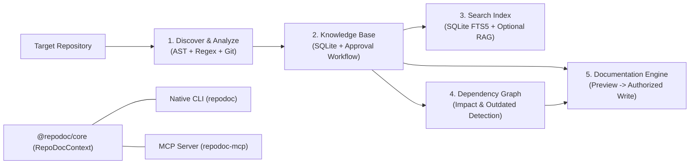

# RepoDocAgent

> **Language / Idioma:** **English** | [Português (Brasil)](./README_PT_BR.md)

**RepoDocAgent** is an agnostic platform for repository analysis, structured software knowledge management, and incremental technical and business documentation generation.

It acts as a persistent intelligence layer over any codebase—independent of programming language, AI model provider, or external coding agent—turning source code, Git history, architectural decisions, and human Q&A into a queryable knowledge base and traceable Markdown documentation.

---

## Key Capabilities

- **Repository Discovery & AST Analysis** (`@repodoc/repository`, `@repodoc/analyzer`): Detects languages, workspace monorepos (`pnpm`, `npm`, `yarn`, `lerna`, `turborepo`, `cargo`), Git state, and extracts symbols, imports, exports, visibility, and docstrings via the TypeScript Compiler API (for TS/JS) plus a regex fallback parser for other languages (Python, Go, Java, etc.).
- **Structured Knowledge Management** (`@repodoc/knowledge`, `@repodoc/persistence`): Persists knowledge items in SQLite with provenance (`confirmed` vs. `inferred`), approval workflows (`manual` or `automatic`), relationships, and Q&A sessions.
- **Configurable Documentation Engine** (`@repodoc/documentation`): Generates technical and business Markdown documentation with Mermaid architecture/dependency diagrams, configurable depth (`overview`, `standard`, `detailed`, `comprehensive`), independent target language (`en`, `pt-BR`, `es`, etc.), section-level traceability, and non-destructive `preview` mode.
- **Git Intelligence & Dependency Graph** (`@repodoc/git-intelligence`, `@repodoc/dependency-graph`): Builds a persistent directed graph linking modules, files, symbols, knowledge items, and documentation to compute transitive change impacts and detect outdated docs.
- **Full-Text Search & Optional RAG** (`@repodoc/indexer`): Provides offline SQLite FTS5 (`bm25`) and structural search by default, with optional abstractions (`EmbeddingProvider`, `RerankerProvider`) for semantic and hybrid retrieval.
- **Provider-Agnostic AI Layer** (`@repodoc/ai-provider`): Supports OpenAI and OpenAI-compatible endpoints (DeepSeek, SiliconFlow, OpenRouter), Anthropic, Google Gemini, and local Ollama, with Zod-validated structured outputs and automatic fallback chains.
- **Centralized Security & Authorization** (`@repodoc/permissions`): Enforces explicit write authorization (`docs_write`, `file_create`, etc.) and path traversal protection (`assertSafePath`) on every physical mutation.

---

## How It Works (Core Workflow)



1. **Discover & Analyze:** Scans files respecting `.gitignore` and `.repodoc/config.yaml`, parses symbols/imports, and ingests structured knowledge items.
2. **Review & Approve:** In `manual` approval mode, inferred items stay `pending` until approved; confirmed Q&A answers and manual entries are immediately `approved`.
3. **Index & Graph:** Updates SQLite FTS5 search chunks and persists the dependency graph linking files → symbols → knowledge → docs.
4. **Preview & Generate:** Previews Markdown + Mermaid documents in memory (`docs preview`) and writes to disk only when explicitly authorized (`--yes` in CLI or `authorized: true` in MCP).
5. **Track Evolution:** Compares working tree or Git refs (`docs status`, `git changes`) to identify impacted knowledge and propose incremental documentation updates.

---

## Tech Stack

| Layer | Technologies |
| :--- | :--- |
| **Runtime & Language** | Node.js (>= 20, built on v22.20.0), TypeScript 5.7 (`strict`, ESM / `NodeNext`) |
| **Monorepo & Build** | `pnpm` workspaces (`pnpm@11.9.0`), TypeScript Project References (`tsc --build`) |
| **Persistence & Search** | SQLite via `better-sqlite3`, SQLite FTS5 (`bm25`) |
| **Code Parsing** | TypeScript Compiler API (`typescript`), regex fallback parser |
| **Validation & Config** | `zod`, `yaml`, `fast-glob`, `ignore` |
| **Diagrams & Docs** | Markdown, Mermaid (`flowchart TD`, `graph LR`) |
| **Integration** | Native CLI (`node:util` `parseArgs`), MCP JSON-RPC 2.0 over `stdio` |
| **Testing** | Vitest 3 (`vitest run`) |

---

## Monorepo Structure

```text
repo-doc-agent/
├── apps/
│   ├── cli/                # Native CLI (`repodoc`)
│   └── mcp-server/         # MCP Server over stdio (`repodoc-mcp`)
├── packages/
│   ├── shared/             # Shared types, KnowledgeItem schemas, logger, and errors
│   ├── configuration/      # Zod config schemas and `.repodoc/config.yaml` loader
│   ├── permissions/        # PermissionsEngine and path traversal guards
│   ├── persistence/        # SQLite connection, migrations (001-004), and repositories
│   ├── repository/         # File scanner, language detector, monorepo & Git inspector
│   ├── analyzer/           # TypeScript AST parser and generic regex parser
│   ├── knowledge/          # Knowledge ingestor, approval service, and Q&A sessions
│   ├── documentation/      # Technical & business Markdown builders and Mermaid generator
│   ├── dependency-graph/   # Directed graph and transitive impact analyzer
│   ├── git-intelligence/   # Read-only Git diff analyzer and outdated doc detector
│   ├── indexer/            # Text chunker, FTS5 search, and optional vector/hybrid RAG
│   ├── ai-provider/        # Provider contracts, HTTP adapters, and fallback engine
│   └── core/               # Central orchestrator (`RepoDocContext`)
├── docs/
│   ├── repodoc/            # Self-generated documentation for this repository
│   └── LIMITATIONS_AND_ROADMAP.md
└── .repodoc/
    └── config.yaml         # Project configuration
```

---

## Getting Started

### Prerequisites

- **Node.js** `>= 20` (tested with `v22.20.0`)
- **pnpm** `>= 10` (configured with `pnpm@11.9.0`)
- **Git** (optional, required for Git intelligence features)

### Install, Build, and Global CLI Setup

```bash
pnpm install
pnpm run link:global
```

`pnpm run link:global` compiles all workspace packages, bundles standalone executables (`dist/repodoc.mjs` and `dist/repodoc-mcp.mjs`), and links `repodoc` and `repodoc-mcp` globally on your machine so you can run them from **any repository directory**.

To unlink later:

```bash
pnpm run unlink:global
```

#### Running with `npx`

Once built (`pnpm run build:all`), you can also invoke the standalone bundle via `npx` from any project directory without global linking:

```bash
npx --package /absolute/path/to/repo-doc-agent repodoc --help
```

#### Build & Test Only

```bash
pnpm run build:all
pnpm run test
pnpm run typecheck
```

---

## CLI Usage (`repodoc`)

The CLI works **100% offline** for structural analysis, FTS5 search, dependency graphs, and deterministic documentation generation. Every command supports `--json` for automation and `--project <path>` to target another repository.

### Common Workflows

```bash
# 1. Show CLI help
repodoc --help

# 2. Inspect resolved project configuration (secrets are redacted)
repodoc config show --json

# 3. Discover files, parse symbols, ingest knowledge, and populate FTS5 index
repodoc analyze

# 4. Inspect pending knowledge items and approve one by ID
repodoc knowledge pending
repodoc knowledge approve <item-id>

# 5. Search symbols, knowledge, and indexed docs
repodoc search "PermissionsEngine" --mode fulltext --json

# 6. Ask a question (retrieves contextual chunks + opens a Q&A session)
repodoc ask "How is write authorization enforced?"

# 7. Preview documentation in memory without touching the filesystem
repodoc docs preview --depth detailed --language en

# 8. Generate documentation on disk (requires explicit --yes authorization)
repodoc docs generate --yes --depth detailed --language en --output ./docs/repodoc

# 9. Check Git changes and detect outdated documentation
repodoc git changes
repodoc docs status --base HEAD~1

# 10. Build and persist the dependency graph
repodoc graph --json
```

> **Authorization rule:** Running `repodoc docs generate` without `--yes` exits with code `2` (`Permission denied`) and writes nothing to disk.

---

## MCP Server Integration (`repodoc-mcp`)

The MCP server exposes **14 tools**, **5 resources**, and **5 prompts** over JSON-RPC 2.0 `stdio`, allowing external coding agents to query project knowledge without duplicating business logic.

### Start Manually

```bash
repodoc mcp start
# or directly:
repodoc-mcp /path/to/target-repo
```

### Client Configuration (Antigravity, Claude Code, Codex, OpenCode)

Add the following entry to your MCP client configuration file (if installed globally via `pnpm run link:global`):

```json
{
  "mcpServers": {
    "repodoc": {
      "command": "repodoc-mcp",
      "args": ["/absolute/path/to/target-repo"]
    }
  }
}
```

Or without global installation, pointing directly to the bundled entrypoint:

```json
{
  "mcpServers": {
    "repodoc": {
      "command": "node",
      "args": [
        "/absolute/path/to/repo-doc-agent/dist/repodoc-mcp.mjs",
        "/absolute/path/to/target-repo"
      ]
    }
  }
}
```

### Available MCP Tools, Resources, and Prompts

- **Tools (14):** `analyze_repository`, `get_project_overview`, `search_repository`, `search_knowledge`, `get_dependency_impact`, `ask_repository`, `register_knowledge`, `approve_knowledge`, `get_pending_knowledge`, `analyze_git_changes`, `get_documentation_status`, `preview_documentation_changes`, `generate_documentation` *(requires `authorized: true`)*, `get_project_configuration`.
- **Resources (5):** `repodoc://overview`, `repodoc://config`, `repodoc://knowledge`, `repodoc://graph`, `repodoc://docs/status`.
- **Prompts (5):** `analyze-repository`, `understand-architecture`, `investigate-business-rule`, `identify-change-impacts`, `update-documentation`.

---

## Project Configuration (`.repodoc/config.yaml`)

```yaml
version: 1

project:
  name: my-project
  description: "Project description"

documentation:
  language: en        # e.g., en, pt-BR, es, fr, de
  depth: detailed     # overview | standard | detailed | comprehensive
  destination:
    type: local
    path: ./docs/repodoc
  update:
    mode: manual      # manual | automatic
    incremental: true

knowledge:
  approval:
    mode: manual      # manual | automatic

analysis:
  include:
    - packages/**
    - apps/**
  exclude:
    - node_modules/**
    - dist/**
    - coverage/**
    - .git/**
    - .repodoc/**

ai:
  provider: default   # default (offline) | openai | anthropic | google | deepseek | siliconflow | openrouter | ollama
  model: default

integrations:
  mcp:
    enabled: true
```

> **Security note:** Never store API keys or credentials in version-controlled files. Provide them via environment variables (`OPENAI_API_KEY`, `ANTHROPIC_API_KEY`, `GEMINI_API_KEY`, `DEEPSEEK_API_KEY`, etc.).

---

## Testing & Security

Run the full test suite (unit, integration, E2E multi-language, and security boundary tests):

```bash
pnpm run test
```

The test suite verifies:
- Path traversal rejection (`PathTraversalError`) across permissions and documentation output paths.
- Mandatory explicit authorization (`PermissionDeniedError`) for physical writes via Core, CLI, and MCP.
- Read-only Git inspection with flag-injection validation (`assertSafeGitRef`).
- End-to-end polyglot pipeline (`TypeScript`, `Python`, `Go`) with inert handling of untrusted source comments.

For known limitations and planned improvements, see [docs/LIMITATIONS_AND_ROADMAP.md](./docs/LIMITATIONS_AND_ROADMAP.md).
