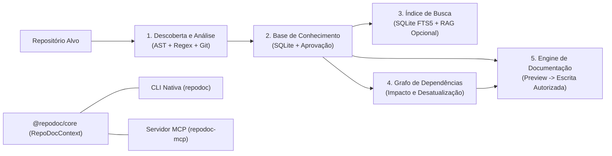

# RepoDocAgent

> **Idioma / Language:** [English](./README.md) | **Português (Brasil)**

O **RepoDocAgent** é uma plataforma agnóstica para análise de repositórios, gestão estruturada de conhecimento de software e geração/manutenção incremental de documentação técnica e de negócio.

Ele atua como uma camada persistente de inteligência sobre qualquer base de código — independente de linguagem de programação, provedor de modelo de IA ou agente externo — transformando código-fonte, histórico Git, decisões arquiteturais e sessões de Q&A em uma base de conhecimento consultável e documentação Markdown rastreável.

---

## Principais Capacidades

- **Descoberta de Repositório e Análise AST** (`@repodoc/repository`, `@repodoc/analyzer`): detecta linguagens, monorepos (`pnpm`, `npm`, `yarn`, `lerna`, `turborepo`, `cargo`), estado do Git e extrai símbolos, imports, exports, visibilidade e docstrings via TypeScript Compiler API (para TS/JS) e parser genérico via regex para outras linguagens (Python, Go, Java, etc.).
- **Gestão Estruturada de Conhecimento** (`@repodoc/knowledge`, `@repodoc/persistence`): persiste itens de conhecimento em SQLite com proveniência (`confirmed` vs. `inferred`), fluxo de aprovação (`manual` ou `automatic`), relacionamentos e sessões de Q&A.
- **Engine de Documentação Configurável** (`@repodoc/documentation`): gera documentação técnica e de negócio em Markdown com diagramas Mermaid de arquitetura e dependências, profundidade configurável (`overview`, `standard`, `detailed`, `comprehensive`), idioma independente (`en`, `pt-BR`, `es`, etc.), rastreabilidade por seção e modo `preview` não destrutivo.
- **Git Intelligence e Grafo de Dependências** (`@repodoc/git-intelligence`, `@repodoc/dependency-graph`): constrói um grafo direcionado persistido conectando módulos, arquivos, símbolos, itens de conhecimento e documentos para calcular impacto transitivo de alterações e detectar documentação desatualizada.
- **Busca Full-Text e RAG Opcional** (`@repodoc/indexer`): oferece busca offline com SQLite FTS5 (`bm25`) e busca estrutural por padrão, com abstrações opcionais (`EmbeddingProvider`, `RerankerProvider`) para busca semântica e híbrida.
- **Camada Agnóstica de Provedores de IA** (`@repodoc/ai-provider`): suporta OpenAI e endpoints compatíveis (DeepSeek, SiliconFlow, OpenRouter), Anthropic, Google Gemini e Ollama local, com *structured output* validado por Zod e cadeia automática de *fallback*.
- **Segurança e Autorização Centralizada** (`@repodoc/permissions`): exige autorização explícita (`docs_write`, `file_create`, etc.) e validação contra *path traversal* (`assertSafePath`) antes de qualquer mutação física.

---

## Como Funciona (Fluxo Principal)



1. **Descoberta e Análise:** escaneia arquivos respeitando `.gitignore` e `.repodoc/config.yaml`, extrai símbolos/imports e ingere itens de conhecimento estruturados.
2. **Revisão e Aprovação:** no modo `manual`, itens inferidos permanecem `pending` até serem aprovados; respostas confirmadas de Q&A e registros manuais entram como `approved`.
3. **Indexação e Grafo:** atualiza os chunks FTS5 no SQLite e persiste o grafo conectando arquivos → símbolos → conhecimento → documentos.
4. **Preview e Geração:** gera o preview Markdown + Mermaid em memória (`docs preview`) e só grava em disco mediante autorização explícita (`--yes` na CLI ou `authorized: true` no MCP).
5. **Evolução Contínua:** compara working tree ou refs Git (`docs status`, `git changes`) para identificar conhecimento impactado e propor atualizações incrementais.

---

## Stack Tecnológica

| Camada | Tecnologias |
| :--- | :--- |
| **Runtime e Linguagem** | Node.js (>= 20, desenvolvido na v22.20.0), TypeScript 5.7 (`strict`, ESM / `NodeNext`) |
| **Monorepo e Build** | `pnpm` workspaces (`pnpm@11.9.0`), TypeScript Project References (`tsc --build`) |
| **Persistência e Busca** | SQLite via `better-sqlite3`, SQLite FTS5 (`bm25`) |
| **Análise de Código** | TypeScript Compiler API (`typescript`), parser genérico por regex |
| **Validação e Config** | `zod`, `yaml`, `fast-glob`, `ignore` |
| **Diagramas e Docs** | Markdown, Mermaid (`flowchart TD`, `graph LR`) |
| **Integração** | CLI nativa (`node:util` `parseArgs`), MCP JSON-RPC 2.0 sobre `stdio` |
| **Testes** | Vitest 3 (`vitest run`) |

---

## Estrutura do Monorepo

```text
repo-doc-agent/
├── apps/
│   ├── cli/                # CLI nativa (`repodoc`)
│   └── mcp-server/         # Servidor MCP sobre stdio (`repodoc-mcp`)
├── packages/
│   ├── shared/             # Tipos compartilhados, schemas de KnowledgeItem, logger e erros
│   ├── configuration/      # Schemas Zod e loader de `.repodoc/config.yaml`
│   ├── permissions/        # PermissionsEngine e proteção contra path traversal
│   ├── persistence/        # Conexão SQLite, migrações (001-004) e repositórios
│   ├── repository/         # Scanner de arquivos, detector de linguagens, monorepo e Git
│   ├── analyzer/           # Parser AST TypeScript e parser genérico por regex
│   ├── knowledge/          # Ingestão de conhecimento, serviço de aprovação e Q&A
│   ├── documentation/      # Builders técnico/negócio em Markdown e gerador Mermaid
│   ├── dependency-graph/   # Grafo direcionado e análise de impacto transitivo
│   ├── git-intelligence/   # Análise de diff Git somente leitura e detector de desatualização
│   ├── indexer/            # TextChunker, busca FTS5 e RAG vetorial/híbrido opcional
│   ├── ai-provider/        # Contratos de provedores, adapters HTTP e engine de fallback
│   └── core/               # Orquestrador central (`RepoDocContext`)
├── docs/
│   ├── repodoc/            # Autodocumentação gerada para este repositório
│   └── LIMITATIONS_AND_ROADMAP.md
└── .repodoc/
    └── config.yaml         # Configuração do projeto
```

---

## Como Instalar e Rodar

### Pré-requisitos

- **Node.js** `>= 20` (testado com `v22.20.0`)
- **pnpm** `>= 10` (configurado com `pnpm@11.9.0`)
- **Git** (opcional, necessário para recursos de Git Intelligence)

### Instalação, Build e Comando Global

```bash
pnpm install
pnpm run link:global
```

O comando `pnpm run link:global` compila todos os pacotes, gera os executáveis standalone (`dist/repodoc.mjs` e `dist/repodoc-mcp.mjs`) e registra os comandos `repodoc` e `repodoc-mcp` globalmente na sua máquina para uso em **qualquer pasta de projeto**.

Para remover o link global posteriormente:

```bash
pnpm run unlink:global
```

#### Executando via `npx`

Após gerar o bundle (`pnpm run build:all`), também é possível executar diretamente de qualquer pasta via `npx` sem instalar globalmente:

```bash
npx --package /caminho/absoluto/para/repo-doc-agent repodoc --help
```

#### Apenas Build e Testes

```bash
pnpm run build:all
pnpm run test
pnpm run typecheck
```

---

## Uso da CLI (`repodoc`)

A CLI funciona **100% offline** para análise estrutural, busca FTS5, grafo de dependências e geração determinística de documentação. Todos os comandos aceitam `--json` para automação e `--project <path>` para apontar para outro repositório.

### Exemplos de Fluxos Comuns

```bash
# 1. Exibir ajuda
repodoc --help

# 2. Inspecionar configuração resolvida (segredos são omitidos)
repodoc config show --json

# 3. Descobrir arquivos, analisar símbolos, ingerir conhecimento e indexar no FTS5
repodoc analyze

# 4. Listar itens pendentes e aprovar um item por ID
repodoc knowledge pending
repodoc knowledge approve <item-id>

# 5. Buscar símbolos, conhecimento e documentação indexada
repodoc search "PermissionsEngine" --mode fulltext --json

# 6. Fazer uma pergunta (recupera contexto relevante e registra sessão Q&A)
repodoc ask "How is write authorization enforced?"

# 7. Gerar preview em memória sem escrever arquivos no disco
repodoc docs preview --depth detailed --language en

# 8. Gravar documentação em disco (exige autorização explícita --yes)
repodoc docs generate --yes --depth detailed --language en --output ./docs/repodoc

# 9. Verificar alterações Git e detectar documentação desatualizada
repodoc git changes
repodoc docs status --base HEAD~1

# 10. Construir e persistir o grafo de dependências
repodoc graph --json
```

> **Regra de autorização:** executar `repodoc docs generate` sem `--yes` retorna código de saída `2` (`Permission denied`) e não grava nenhum arquivo.

---

## Integração com Servidor MCP (`repodoc-mcp`)

O servidor MCP expõe **14 tools**, **5 resources** e **5 prompts** via JSON-RPC 2.0 sobre `stdio`, permitindo que agentes externos consultem o conhecimento do projeto sem duplicar regras de negócio.

### Iniciar Manualmente

```bash
repodoc mcp start
# ou diretamente:
repodoc-mcp /caminho/para/o/projeto-alvo
```

### Configuração em Clientes MCP (Antigravity, Claude Code, Codex, OpenCode)

Se instalado globalmente via `pnpm run link:global`, adicione a configuração abaixo ao arquivo MCP do seu cliente:

```json
{
  "mcpServers": {
    "repodoc": {
      "command": "repodoc-mcp",
      "args": ["/caminho/absoluto/para/o/projeto-alvo"]
    }
  }
}
```

Ou sem instalação global, apontando diretamente para o bundle gerado:

```json
{
  "mcpServers": {
    "repodoc": {
      "command": "node",
      "args": [
        "/caminho/absoluto/para/repo-doc-agent/dist/repodoc-mcp.mjs",
        "/caminho/absoluto/para/o/projeto-alvo"
      ]
    }
  }
}
```

### Tools, Resources e Prompts Disponíveis

- **Tools (14):** `analyze_repository`, `get_project_overview`, `search_repository`, `search_knowledge`, `get_dependency_impact`, `ask_repository`, `register_knowledge`, `approve_knowledge`, `get_pending_knowledge`, `analyze_git_changes`, `get_documentation_status`, `preview_documentation_changes`, `generate_documentation` *(exige `authorized: true`)*, `get_project_configuration`.
- **Resources (5):** `repodoc://overview`, `repodoc://config`, `repodoc://knowledge`, `repodoc://graph`, `repodoc://docs/status`.
- **Prompts (5):** `analyze-repository`, `understand-architecture`, `investigate-business-rule`, `identify-change-impacts`, `update-documentation`.

---

## Configuração do Projeto (`.repodoc/config.yaml`)

```yaml
version: 1

project:
  name: my-project
  description: "Project description"

documentation:
  language: en        # ex.: en, pt-BR, es, fr, de
  depth: detailed     # overview | standard | detailed | comprehensive
  destination:
    type: local
    path: ./docs/repodoc
  update:
    mode: manual      # manual | automatic
    incremental: true

knowledge:
  approval:
    mode: manual      # manual | automatic

analysis:
  include:
    - packages/**
    - apps/**
  exclude:
    - node_modules/**
    - dist/**
    - coverage/**
    - .git/**
    - .repodoc/**

ai:
  provider: default   # default (offline) | openai | anthropic | google | deepseek | siliconflow | openrouter | ollama
  model: default

integrations:
  mcp:
    enabled: true
```

> **Nota de segurança:** nunca armazene chaves de API ou credenciais em arquivos versionados. Utilize variáveis de ambiente (`OPENAI_API_KEY`, `ANTHROPIC_API_KEY`, `GEMINI_API_KEY`, `DEEPSEEK_API_KEY`, etc.).

---

## Testes e Segurança

Execute a suíte completa (testes unitários, de integração, E2E multi-linguagem e limites de segurança):

```bash
pnpm run test
```

A suíte valida:
- Bloqueio contra *path traversal* (`PathTraversalError`) em permissões e diretórios de saída de documentação.
- Exigência de autorização explícita (`PermissionDeniedError`) para escritas físicas via Core, CLI e MCP.
- Inspeção Git somente leitura com validação contra injeção de flags (`assertSafeGitRef`).
- Pipeline E2E poliglota (`TypeScript`, `Python`, `Go`) tratando comentários não confiáveis como dados inertes.

Para limitações conhecidas e melhorias planejadas, consulte [docs/LIMITATIONS_AND_ROADMAP.md](./docs/LIMITATIONS_AND_ROADMAP.md).
