# repo-doc-agent — System Architecture

> Language: `en` | Depth: `detailed` | Generated at: `2026-11-23T14:25:08.432Z`

## Modules & Packages

### Module: @repodoc/ai-provider

Workspace package '@repodoc/ai-provider' located at 'packages/ai-provider'.

- Sources: `packages/ai-provider/package.json`

### Module: @repodoc/analyzer

Workspace package '@repodoc/analyzer' located at 'packages/analyzer'.

- Sources: `packages/analyzer/package.json`

### Module: @repodoc/core

Workspace package '@repodoc/core' located at 'packages/core'.

- Sources: `packages/core/package.json`

### Module: @repodoc/configuration

Workspace package '@repodoc/configuration' located at 'packages/configuration'.

- Sources: `packages/configuration/package.json`

### Module: @repodoc/dependency-graph

Workspace package '@repodoc/dependency-graph' located at 'packages/dependency-graph'.

- Sources: `packages/dependency-graph/package.json`

### Module: @repodoc/git-intelligence

Workspace package '@repodoc/git-intelligence' located at 'packages/git-intelligence'.

- Sources: `packages/git-intelligence/package.json`

### Module: @repodoc/documentation

Workspace package '@repodoc/documentation' located at 'packages/documentation'.

- Sources: `packages/documentation/package.json`

### Module: @repodoc/indexer

Workspace package '@repodoc/indexer' located at 'packages/indexer'.

- Sources: `packages/indexer/package.json`

### Module: @repodoc/knowledge

Workspace package '@repodoc/knowledge' located at 'packages/knowledge'.

- Sources: `packages/knowledge/package.json`

### Module: @repodoc/permissions

Workspace package '@repodoc/permissions' located at 'packages/permissions'.

- Sources: `packages/permissions/package.json`

### Module: @repodoc/persistence

Workspace package '@repodoc/persistence' located at 'packages/persistence'.

- Sources: `packages/persistence/package.json`

### Module: @repodoc/repository

Workspace package '@repodoc/repository' located at 'packages/repository'.

- Sources: `packages/repository/package.json`

### Module: @repodoc/shared

Workspace package '@repodoc/shared' located at 'packages/shared'.

- Sources: `packages/shared/package.json`

### Module: @repodoc/cli

Workspace package '@repodoc/cli' located at 'apps/cli'.

- Sources: `apps/cli/package.json`

### Module: @repodoc/mcp-server

Workspace package '@repodoc/mcp-server' located at 'apps/mcp-server'.

- Sources: `apps/mcp-server/package.json`
<!-- traceability: a98f381649cc25fd, 8930b39ed35f6180, f9fa74cd626a1687, eda340ec6a60d1c7, 2faf6e56f8cd2d5b, e40fde639d229124, 59c591b62cd532bc, 5a5c7bfd1e659b0b, 9e7702e78c6618a9, df4a8b05e8b76c40, 85862cd51d35580a, 2d12120de67bdec6, 8ffd676dbff76bf0, 18a3f6f5e330d90d, 700abb61bc0bad79 -->

## External Dependencies

### External Dependencies

External packages referenced in the codebase:
- @repodoc/ai-provider
- @repodoc/analyzer
- @repodoc/configuration
- @repodoc/core
- @repodoc/dependency-graph
- @repodoc/documentation
- @repodoc/git-intelligence
- @repodoc/indexer
- @repodoc/knowledge
- @repodoc/mcp-server
- @repodoc/permissions
- @repodoc/persistence
- @repodoc/repository
- @repodoc/shared
- better-sqlite3
- fast-glob
- ignore
- node:child_process
- node:crypto
- node:fs/promises
- node:os
- node:path
- node:readline
- node:url
- node:util
- typescript
- vitest
- yaml
- zod
<!-- traceability: de8a4ba2187a7abc -->

## Internal Module Dependencies

```mermaid
graph LR
  node_packages_ai_provider_src_engine_ts["packages/ai-provider/src/engine.ts"]
  node_repodoc_shared["@repodoc/shared"]
  node_packages_ai_provider_src_engine_ts --> node_repodoc_shared
  node_repodoc_indexer["@repodoc/indexer"]
  node_packages_ai_provider_src_engine_ts --> node_repodoc_indexer
  node_types_js["./types.js"]
  node_packages_ai_provider_src_engine_ts --> node_types_js
  node_packages_ai_provider_src_index_ts["packages/ai-provider/src/index.ts"]
  node_packages_ai_provider_src_index_ts --> node_types_js
  node_providers_base_http_provider_js["./providers/base-http-provider.js"]
  node_packages_ai_provider_src_index_ts --> node_providers_base_http_provider_js
  node_providers_openai_compatible_js["./providers/openai-compatible.js"]
  node_packages_ai_provider_src_index_ts --> node_providers_openai_compatible_js
  node_providers_anthropic_js["./providers/anthropic.js"]
  node_packages_ai_provider_src_index_ts --> node_providers_anthropic_js
  node_providers_google_js["./providers/google.js"]
  node_packages_ai_provider_src_index_ts --> node_providers_google_js
  node_providers_ollama_js["./providers/ollama.js"]
  node_packages_ai_provider_src_index_ts --> node_providers_ollama_js
  node_registry_js["./registry.js"]
  node_packages_ai_provider_src_index_ts --> node_registry_js
  node_engine_js["./engine.js"]
  node_packages_ai_provider_src_index_ts --> node_engine_js
  node_packages_ai_provider_src_registry_ts["packages/ai-provider/src/registry.ts"]
  node_repodoc_configuration["@repodoc/configuration"]
  node_packages_ai_provider_src_registry_ts --> node_repodoc_configuration
  node_packages_ai_provider_src_registry_ts --> node_types_js
  node_packages_ai_provider_src_registry_ts --> node_providers_openai_compatible_js
  node_packages_ai_provider_src_registry_ts --> node_providers_anthropic_js
  node_packages_ai_provider_src_registry_ts --> node_providers_google_js
  node_packages_ai_provider_src_registry_ts --> node_providers_ollama_js
  node_packages_ai_provider_src_types_ts["packages/ai-provider/src/types.ts"]
  node_zod["zod"]
  node_packages_ai_provider_src_types_ts --> node_zod
  node_packages_ai_provider_src_types_ts --> node_repodoc_shared
  node_packages_ai_provider_test_ai_provider_test_ts["packages/ai-provider/test/ai-provider.test.ts"]
  node_vitest["vitest"]
  node_packages_ai_provider_test_ai_provider_test_ts --> node_vitest
  node_packages_ai_provider_test_ai_provider_test_ts --> node_zod
  node_src_providers_openai_compatible_js["../src/providers/openai-compatible.js"]
  node_packages_ai_provider_test_ai_provider_test_ts --> node_src_providers_openai_compatible_js
  node_src_providers_anthropic_js["../src/providers/anthropic.js"]
  node_packages_ai_provider_test_ai_provider_test_ts --> node_src_providers_anthropic_js
  node_src_providers_google_js["../src/providers/google.js"]
  node_packages_ai_provider_test_ai_provider_test_ts --> node_src_providers_google_js
  node_src_providers_ollama_js["../src/providers/ollama.js"]
  node_packages_ai_provider_test_ai_provider_test_ts --> node_src_providers_ollama_js
  node_src_registry_js["../src/registry.js"]
  node_packages_ai_provider_test_ai_provider_test_ts --> node_src_registry_js
  node_src_engine_js["../src/engine.js"]
  node_packages_ai_provider_test_ai_provider_test_ts --> node_src_engine_js
  node_src_types_js["../src/types.js"]
  node_packages_ai_provider_test_ai_provider_test_ts --> node_src_types_js
  node_packages_configuration_src_index_ts["packages/configuration/src/index.ts"]
  node_schemas_project_js["./schemas/project.js"]
  node_packages_configuration_src_index_ts --> node_schemas_project_js
  node_schemas_global_js["./schemas/global.js"]
  node_packages_configuration_src_index_ts --> node_schemas_global_js
  node_loader_js["./loader.js"]
  node_packages_configuration_src_index_ts --> node_loader_js
  node_packages_configuration_src_loader_ts["packages/configuration/src/loader.ts"]
  node_node_fs_promises["node:fs/promises"]
  node_packages_configuration_src_loader_ts --> node_node_fs_promises
  node_node_path["node:path"]
  node_packages_configuration_src_loader_ts --> node_node_path
  node_yaml["yaml"]
  node_packages_configuration_src_loader_ts --> node_yaml
  node_packages_configuration_src_loader_ts --> node_repodoc_shared
  node_packages_configuration_src_loader_ts --> node_schemas_project_js
  node_packages_configuration_test_config_test_ts["packages/configuration/test/config.test.ts"]
  node_packages_configuration_test_config_test_ts --> node_vitest
  node_packages_configuration_test_config_test_ts --> node_node_path
  node_src_schemas_project_js["../src/schemas/project.js"]
  node_packages_configuration_test_config_test_ts --> node_src_schemas_project_js
  node_src_loader_js["../src/loader.js"]
  node_packages_configuration_test_config_test_ts --> node_src_loader_js
```

<!-- traceability: a98f381649cc25fd, 8930b39ed35f6180, f9fa74cd626a1687, eda340ec6a60d1c7, 2faf6e56f8cd2d5b, e40fde639d229124, 59c591b62cd532bc, 5a5c7bfd1e659b0b, 9e7702e78c6618a9, df4a8b05e8b76c40, 85862cd51d35580a, 2d12120de67bdec6, 8ffd676dbff76bf0, 18a3f6f5e330d90d, 700abb61bc0bad79 -->

## Architectural Decisions

No verified entries available for this section yet.

## Configurations & Enums

No verified entries available for this section yet.

## Traceability

- **Knowledge Item IDs:** `a98f381649cc25fd`, `8930b39ed35f6180`, `f9fa74cd626a1687`, `eda340ec6a60d1c7`, `2faf6e56f8cd2d5b`, `e40fde639d229124`, `59c591b62cd532bc`, `5a5c7bfd1e659b0b`, `9e7702e78c6618a9`, `df4a8b05e8b76c40`, `85862cd51d35580a`, `2d12120de67bdec6`, `8ffd676dbff76bf0`, `18a3f6f5e330d90d`, `700abb61bc0bad79`, `de8a4ba2187a7abc`
- **Referenced Source Files:** `packages/ai-provider/package.json`, `packages/analyzer/package.json`, `packages/core/package.json`, `packages/configuration/package.json`, `packages/dependency-graph/package.json`, `packages/git-intelligence/package.json`, `packages/documentation/package.json`, `packages/indexer/package.json`, `packages/knowledge/package.json`, `packages/permissions/package.json`, `packages/persistence/package.json`, `packages/repository/package.json`, `packages/shared/package.json`, `apps/cli/package.json`, `apps/mcp-server/package.json`
