# repo-doc-agent — System Architecture

> Language: `en` | Depth: `detailed` | Generated at: `2026-11-23T13:02:08.303Z`

## Modules & Packages

No verified entries available for this section yet.

## External Dependencies

No verified entries available for this section yet.

## Internal Module Dependencies

```mermaid
graph LR
  node_packages_ai_provider_src_engine_ts["packages/ai-provider/src/engine.ts"]
  node_repodoc_shared["@repodoc/shared"]
  node_packages_ai_provider_src_engine_ts --> node_repodoc_shared
  node_repodoc_indexer["@repodoc/indexer"]
  node_packages_ai_provider_src_engine_ts --> node_repodoc_indexer
  node_types_js["./types.js"]
  node_packages_ai_provider_src_engine_ts --> node_types_js
  node_packages_ai_provider_src_index_ts["packages/ai-provider/src/index.ts"]
  node_packages_ai_provider_src_index_ts --> node_types_js
  node_providers_base_http_provider_js["./providers/base-http-provider.js"]
  node_packages_ai_provider_src_index_ts --> node_providers_base_http_provider_js
  node_providers_openai_compatible_js["./providers/openai-compatible.js"]
  node_packages_ai_provider_src_index_ts --> node_providers_openai_compatible_js
  node_providers_anthropic_js["./providers/anthropic.js"]
  node_packages_ai_provider_src_index_ts --> node_providers_anthropic_js
  node_providers_google_js["./providers/google.js"]
  node_packages_ai_provider_src_index_ts --> node_providers_google_js
  node_providers_ollama_js["./providers/ollama.js"]
  node_packages_ai_provider_src_index_ts --> node_providers_ollama_js
  node_registry_js["./registry.js"]
  node_packages_ai_provider_src_index_ts --> node_registry_js
  node_engine_js["./engine.js"]
  node_packages_ai_provider_src_index_ts --> node_engine_js
  node_packages_ai_provider_src_registry_ts["packages/ai-provider/src/registry.ts"]
  node_repodoc_configuration["@repodoc/configuration"]
  node_packages_ai_provider_src_registry_ts --> node_repodoc_configuration
  node_packages_ai_provider_src_registry_ts --> node_types_js
  node_packages_ai_provider_src_registry_ts --> node_providers_openai_compatible_js
  node_packages_ai_provider_src_registry_ts --> node_providers_anthropic_js
  node_packages_ai_provider_src_registry_ts --> node_providers_google_js
  node_packages_ai_provider_src_registry_ts --> node_providers_ollama_js
  node_packages_ai_provider_src_types_ts["packages/ai-provider/src/types.ts"]
  node_zod["zod"]
  node_packages_ai_provider_src_types_ts --> node_zod
  node_packages_ai_provider_src_types_ts --> node_repodoc_shared
  node_packages_ai_provider_test_ai_provider_test_ts["packages/ai-provider/test/ai-provider.test.ts"]
  node_vitest["vitest"]
  node_packages_ai_provider_test_ai_provider_test_ts --> node_vitest
  node_packages_ai_provider_test_ai_provider_test_ts --> node_zod
  node_src_providers_openai_compatible_js["../src/providers/openai-compatible.js"]
  node_packages_ai_provider_test_ai_provider_test_ts --> node_src_providers_openai_compatible_js
  node_src_providers_anthropic_js["../src/providers/anthropic.js"]
  node_packages_ai_provider_test_ai_provider_test_ts --> node_src_providers_anthropic_js
  node_src_providers_google_js["../src/providers/google.js"]
  node_packages_ai_provider_test_ai_provider_test_ts --> node_src_providers_google_js
  node_src_providers_ollama_js["../src/providers/ollama.js"]
  node_packages_ai_provider_test_ai_provider_test_ts --> node_src_providers_ollama_js
  node_src_registry_js["../src/registry.js"]
  node_packages_ai_provider_test_ai_provider_test_ts --> node_src_registry_js
  node_src_engine_js["../src/engine.js"]
  node_packages_ai_provider_test_ai_provider_test_ts --> node_src_engine_js
  node_src_types_js["../src/types.js"]
  node_packages_ai_provider_test_ai_provider_test_ts --> node_src_types_js
  node_packages_analyzer_src_engine_ts["packages/analyzer/src/engine.ts"]
  node_node_fs_promises["node:fs/promises"]
  node_packages_analyzer_src_engine_ts --> node_node_fs_promises
  node_packages_analyzer_src_engine_ts --> node_repodoc_shared
  node_repodoc_repository["@repodoc/repository"]
  node_packages_analyzer_src_engine_ts --> node_repodoc_repository
  node_parsers_registry_js["./parsers/registry.js"]
  node_packages_analyzer_src_engine_ts --> node_parsers_registry_js
  node_packages_analyzer_src_engine_ts --> node_types_js
  node_packages_analyzer_src_index_ts["packages/analyzer/src/index.ts"]
  node_packages_analyzer_src_index_ts --> node_types_js
  node_parsers_interface_js["./parsers/interface.js"]
  node_packages_analyzer_src_index_ts --> node_parsers_interface_js
  node_parsers_typescript_parser_js["./parsers/typescript-parser.js"]
  node_packages_analyzer_src_index_ts --> node_parsers_typescript_parser_js
  node_parsers_generic_parser_js["./parsers/generic-parser.js"]
  node_packages_analyzer_src_index_ts --> node_parsers_generic_parser_js
  node_packages_analyzer_src_index_ts --> node_parsers_registry_js
  node_packages_analyzer_src_index_ts --> node_engine_js
  node_packages_analyzer_test_analyzer_engine_test_ts["packages/analyzer/test/analyzer-engine.test.ts"]
  node_packages_analyzer_test_analyzer_engine_test_ts --> node_vitest
```

## Architectural Decisions

No verified entries available for this section yet.

## Configurations & Enums

No verified entries available for this section yet.

## Traceability

- **Knowledge Item IDs:** none
- **Referenced Source Files:** `packages/ai-provider/package.json`, `packages/analyzer/package.json`, `packages/dependency-graph/package.json`, `packages/core/package.json`, `packages/configuration/package.json`, `packages/documentation/package.json`, `packages/git-intelligence/package.json`, `packages/indexer/package.json`, `packages/knowledge/package.json`, `packages/permissions/package.json`, `packages/persistence/package.json`, `packages/shared/package.json`, `packages/repository/package.json`, `apps/cli/package.json`, `apps/mcp-server/package.json`
